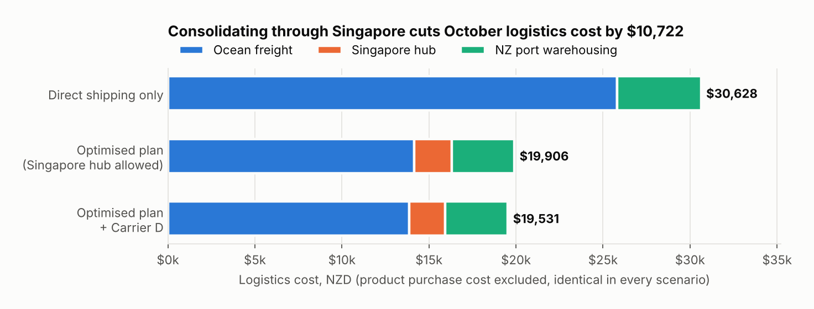
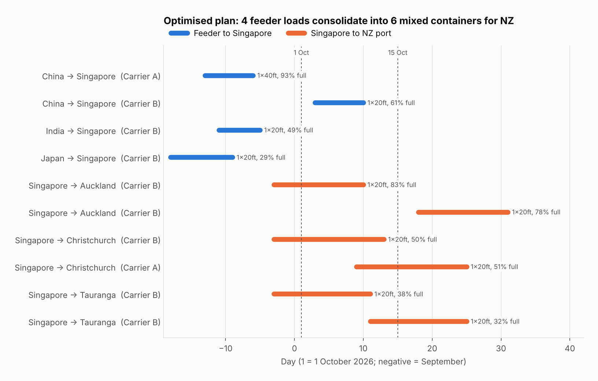
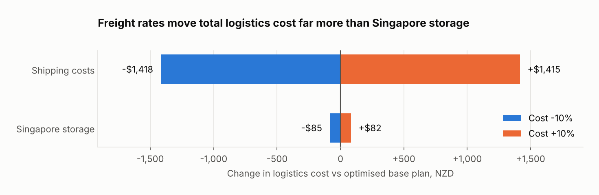

# NZ Import Shipping Optimiser

**Mixed-integer optimisation of a month of Asia → New Zealand imports: which sailings, which
containers, direct or via a Singapore hub — at minimum total cost.**


> **About this repo.** This is a portfolio replica of a case study I worked on in
> Master of Analytics, Auckland University of
> Technology, 2026, for a real New Zealand importer. The client's name and data are
> confidential, so this version uses a **fictional company (Kōwhai Imports Ltd)** and a
> **fully synthetic dataset**. The problem structure and modelling approach mirror the
> original project. The original was built in SAS `proc optmodel`; this is my own
> re-implementation in Python. No figure here comes from the client's data.

## Headline results (synthetic data)

| Scenario | Logistics cost (NZD) | vs optimised plan |
| --- | ---: | ---: |
| Direct shipping only | $30,628 | +53.9% |
| **Optimised plan (direct or via Singapore)** | **$19,906** | — |
| Optimised plan + new provider (Carrier D) | $19,531 | −1.9% |
| Shipping rates ±10% | $18,489 – $21,321 | ±7.1% |
| Singapore storage ±10% | $19,821 – $19,989 | ±0.4% |

Purchase cost ($77,185) is the same in every scenario and is excluded above.

- **Consolidating through Singapore saves about $10,700 (35%)** a month. Each origin's volume
  for each port is too small to fill a container, so direct shipping pays for many
  half-empty boxes.
- **Adding a fourth carrier saves under 2%**: worth negotiating, but not a reason to switch.
- **Freight rates matter ~17× more than hub storage.** Rate negotiation is the lever, not
  warehouse choice in Singapore.







## The problem

Kōwhai Imports sells homeware sourced from China, India and Japan through three New Zealand
ports: Auckland, Tauranga and Christchurch. For goods arriving in October 2026 the
business has to decide:

- how many units of each product to buy,
- which carrier sailings to book, and how many 20ft and 40ft containers on each,
- whether to ship direct or consolidate in Singapore first,
- while meeting each port's demand in each fortnight.

Business rules from the brief:

- minimum order of 2 units per product,
- at most one container (20ft or 40ft) per Singapore → NZ sailing,
- every port receives at least one mixed-product container from Singapore every two weeks.

## Approach

1. **Synthetic data** (`data/generate_data.py`): 10 products, 306 weekly sailings across
   4 fictional carriers, demand by port and fortnight, and warehouse costs. Ranges are
   plausible for the trade lane, but no value comes from a real quote.
2. **MILP model** (`src/shipping_optimiser/model.py`): integer container bookings,
   Singapore flow balance with a minimum 2-day dwell, fortnightly demand, warehouse
   capacity. Full maths in [`docs/formulation.md`](docs/formulation.md).
3. **Cost-benefit analysis** (`run_analysis.py`): direct-only vs consolidation, adding a
   new carrier, and ±10% sensitivity on freight and Singapore storage.
4. **Tests** (`tests/`): check every business rule in the solved plan; they run in CI on each push.

## Run it

```bash
git clone https://github.com/NamrataDatta04/nz-import-shipping-optimiser.git
cd nz-import-shipping-optimiser
pip install -r requirements.txt

python data/generate_data.py   # optional: data/ already holds the generated CSVs
python run_analysis.py         # solves 7 scenarios (~1.5 min), writes results/ and figures/
pytest -q                      # 9 tests
```

## Repo structure

```
data/                  synthetic inputs + the script that generates them
src/shipping_optimiser/
  data.py              loads the CSVs
  model.py             MILP formulation and solution extraction
  scenarios.py         scenarios for the cost-benefit analysis
run_analysis.py        solves all scenarios, saves tables and charts
results/               scenario summary, optimal shipments and purchases (CSV)
figures/               charts used in this README
docs/formulation.md    sets, parameters, variables, objective, constraints
tests/                 business-rule tests (pytest)
```

## Skills shown

Operations research (MILP formulation, integer programming), Python (pandas, PuLP, HiGHS),
scenario and sensitivity analysis, supply-chain cost modelling, data visualisation,
automated testing and CI with GitHub Actions, and turning a model into business recommendations.

## Limitations and next steps

- Unit flows are continuous to keep solves fast; purchases and containers are integer.
- One month horizon, deterministic transit times and rates.
- Next: stochastic transit delays, less-than-container (LCL) pricing, and a Streamlit app for
  live what-if scenarios.

---

Namrata Datta · Master of Analytics, Auckland University of Technology
